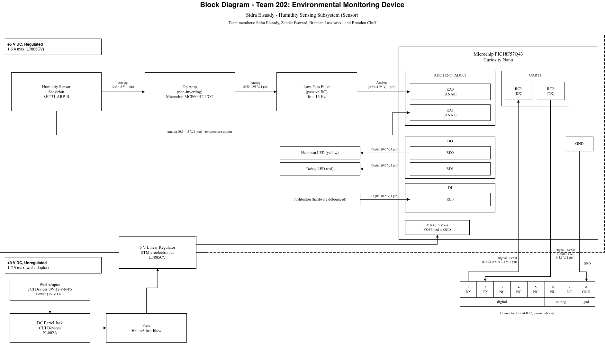

## Overview

This block diagram shows how my humidity sensing board is laid out and how it connects to the rest of Team 202's Environmental Monitoring Device. My board measures relative humidity and sends the reading to Zander Boward's hub board, which shows it on the LCD.

The dashed boxes show the two **power levels** on my board. The bottom box is the unregulated 9 V side, a wall adapter plugs into the barrel jack, and a 500 mA fast-blow fuse protects everything after it. The L7805CV regulator sits across both boxes because it takes in 9 V and puts out a steady 5 V. Everything in the top box runs on that 5 V rail, including the Curiosity Nano, the sensor, the op amp, and the LEDs.

The main signal path runs left to right across the top. The Sensirion SHT31-ARP-B humidity **sensor** outputs an analog voltage from about 0.5 V at 0 %RH to 4.5 V at 100 %RH. That goes into a Microchip MCP6001 op amp set up as a non-inverting amplifier with a gain of 1.1, which stretches the signal to about 0.55 to 4.95 V. A passive RC low-pass filter with a cutoff around 16 Hz then cleans up noise before the signal reaches the ADC on pin RA0. The sensor also has a temperature output, which goes to RA1.

Inside the Curiosity Nano, I'm using four peripherals, the ADC for the two analog signals, UART1 to talk to the hub, digital outputs on RD0 and RD1 for a heartbeat LED and a debug LED, and a digital input on RB0 for a pushbutton with hardware debounce.

My board connects to Zander's hub through **Connector** 1, a 2x4 IDC header on an 8-wire ribbon cable. The hub sends on pin 1 and listens on pin 2, so my board receives on pin 1 (UART RX, RC3) and sends humidity data on pin 2 (UART TX, RC2). Both lines use the team's 3.3 V UART level. Pin 8 is ground, and pins 3 through 7 aren't used.

**This subsystem is sensing only, so there's no actuator.**

## Block Diagram

