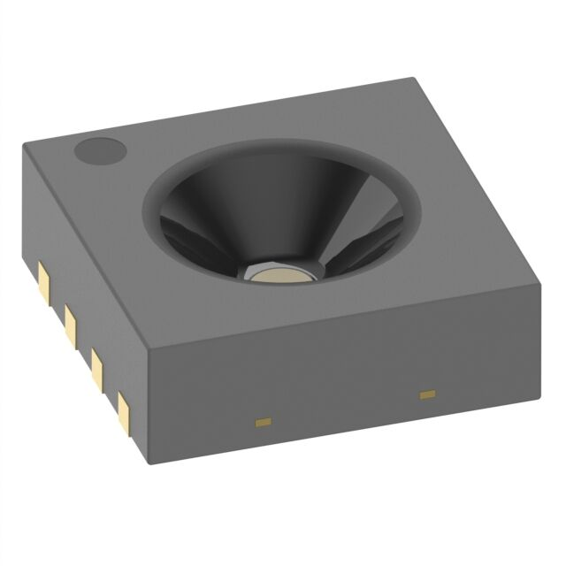
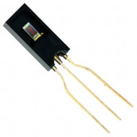
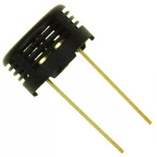
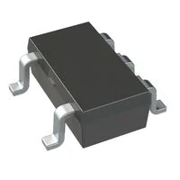
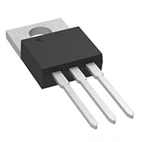
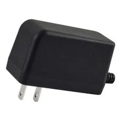
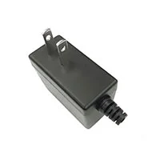
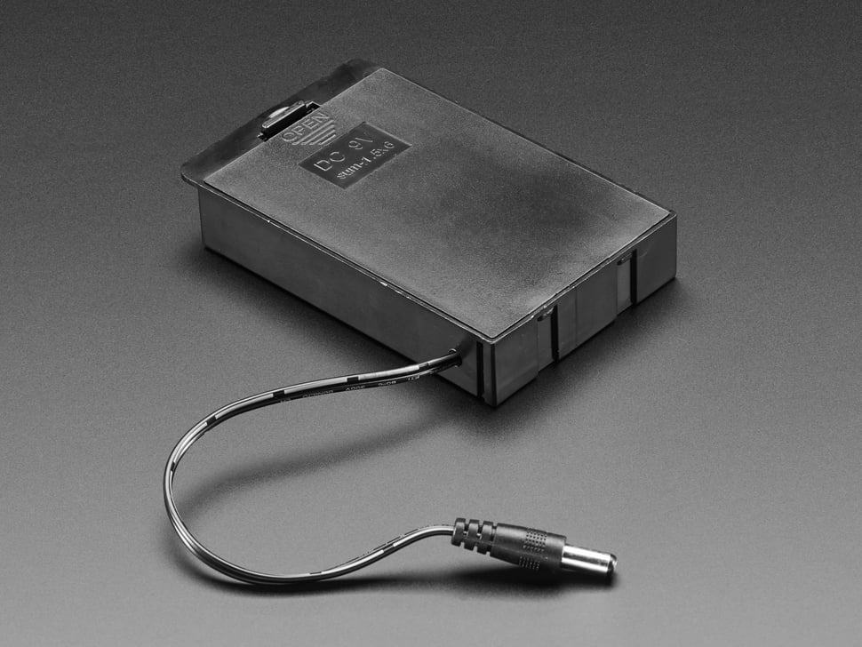

# Component Selection

**Team 202: Environmental Monitoring Device**
**Sidra Elsaady: Humidity Sensing Subsystem (Sensor)**

This page compares at least three candidate solutions for each major block in my subsystem's block diagram, then gives the part I selected and why. Every selection below belongs to the Humidity Sensing Subsystem unless noted otherwise.

The Microchip PIC18F57Q43 Curiosity Nano was selected for us, so it does not get a selection table (it is still included in the power budget). Passives, connectors, pushbuttons, standard LEDs and fuses are excluded from the assignment.

## Design Constraints Used to Judge Options

| Constraint | Value | Source |
|---|---|---|
| Microcontroller | PIC18F57Q43 Curiosity Nano, 12-bit ADCC on RA0 (ANA0) | Course requirement |
| Supply | 9 V DC wall adapter → barrel jack → 5 V linear regulator | Course requirement / PR 1.5 |
| Logic and sensor rail | 5 V (must never exceed 5.5 V at sensor pins) | PR 6.2 |
| Humidity range and accuracy | 0–100 %RH, ±3 %RH or better | PR 2.1 |
| Update rate | New reading at least every 2 s | PR 2.4 |
| Signal path | Real-world signal → conditioning (amplify/filter) → ADC | Project brief |
| Input current limit | ≤ 1.5 A | PR 6.1 |
| Assembly | Hand-solderable by the team; avoid QFN and smaller where possible | Assignment guidance / PR 5.1 |
| Availability | In stock at an authorized distributor at time of order | PR 5.2 |

*Prices are qty-1 prices from authorized distributors (Mouser, Newark, Arrow) as of October 2026 and should be rechecked when ordering.*

---

## 1. Humidity Sensor — Humidity Sensing Subsystem

1. Sensirion SHT31-ARP-B analog humidity/temperature sensor

    

    * $5.00/each (Digi-Key)
    * [SHT31-ARP-B on Digi-Key](https://www.digikey.com/en/products/detail/sensirion-ag/SHT31-ARP-B/5872251)

    | Pros | Cons |
    |---|---|
    | ±2 %RH typical accuracy, which beats our ±3 %RH requirement (PR 2.1) | 2.5 × 2.5 mm DFN-8 package with no leads, so hand soldering needs extended pads, flux and a fine-tip iron (hot air is easier if available) |
    | Factory calibrated, so no humidity chamber is needed to calibrate it | Output can source/sink only ±100 µA, so it needs a high-impedance buffer before the filter and ADC |
    | Ratiometric analog output (10–90 % of VDD) shares the same 5 V reference as the PIC ADC, so supply drift cancels out | Sensitive to heat from nearby parts, so it must be placed away from the L7805 regulator |
    | Runs on 2.4–5.5 V, so it works directly from our 5 V rail |  |
    | Low supply current (350 µA max) |  |
    | Analog output gives our subsystem a real signal-conditioning path (buffer + filter + ADC), as the project brief requires |  |
    | In stock at multiple authorized distributors |  |

1. Honeywell HIH-4000-001 analog humidity sensor

    

    * $241.59/each (Digi-Key)
    * [HIH-4000-001 on Digi-Key](https://www.digikey.com/en/products/detail/honeywell-sensing-and-productivity-solutions/HIH-4000-001/859092)

    | Pros | Cons |
    |---|---|
    | 3-pin through-hole SIP package that is easy to hand solder | ±3.5 %RH accuracy does **not** meet our ±3 %RH requirement |
    | Designed for a 5 V supply (4–5.8 V), matching our rail | Very expensive for one sensor ($241.59 at Digi-Key), with one Digi-Key listing marked not available and a 99-week lead time at another distributor |
    | Near-linear analog voltage output that goes straight to the ADC | Needs temperature compensation in firmware for best accuracy, and we have no separate temperature reading |
    | Long industry track record with lots of example circuits | Larger, so it takes more space near the enclosure vent |

1. Custom: TE Connectivity HPP801A031 (HS1101LF) capacitive humidity sensor + 555 timer oscillator

    

    * about $9 in total
    * [HPP801A031 (HS1101LF) on Digi-Key](https://www.digikey.com/en/products/detail/HS1101LF/HS1101LF-ND/697731)

    | Pros | Cons |
    |---|---|
    | Through-hole leads that are easy to solder | Not factory calibrated; capacitance-to-RH conversion needs a curve fit and calibration with a reference hygrometer |
    | Frequency output can be measured with a PIC timer, which is immune to analog noise on the ribbon cable | Rated ±2 %RH for the sensor alone, but the full circuit's accuracy depends on our own oscillator and calibration, which makes PR 2.1 hard to verify |
    | Building the oscillator ourselves demonstrates custom circuit design | More parts (timer IC + precision resistors) and more board area |
    |  | Limited stock at major distributors at time of research |

**Choice:** Option 1: Sensirion SHT31-ARP-B

**Rationale:** The SHT31-ARP-B is the only option that meets the ±3 %RH accuracy requirement out of the box, because it is factory calibrated at ±2 %RH. Its ratiometric output scales with the same 5 V rail that the PIC ADC uses as a reference, so small regulator variations don't show up as humidity errors. The analog output also fits the course requirement to condition a real-world signal before digitizing it. The HIH-4000 is easier to solder, but it misses the accuracy spec and costs about 48 times as much on Digi-Key with very limited availability. The HS1101LF would need a calibration process we can't verify against PR 2.1. The main risk with the SHT31 is its DFN package. We will reduce that risk by extending the footprint's pads about 0.75 mm past the package so they can be soldered with a fine-tip iron and flux, and by adding a via under the center pad so it can be soldered from the back of the board. The center pad is only needed for mechanical strength (it is internally tied to VSS, per datasheet §3.4). If the lab's hot-air station or reflow oven is available we will use it instead, and we will order spares at $5 each.

---

## 2. Signal Buffer (Op Amp) — Humidity Sensing Subsystem

1. Microchip MCP6001T-I/OT single rail-to-rail op amp (SOT-23-5)

    

    * =$0.30/each
    * [MCP6001T-I/OT on Digi-Key](https://www.digikey.com/en/products/result?keywords=MCP6001T-I%2FOT)

    | Pros | Cons |
    |---|---|
    | Rail-to-rail input and output, so it passes the full 0.5–4.5 V sensor range on a single 5 V supply | SOT-23-5 is small (0.95 mm pitch) but still hand-solderable |
    | Very low quiescent current (100 µA typical, 170 µA max) | Only one amplifier per package, so a second filter stage would need another chip |
    | Runs on 1.8–6.0 V, so it works on our 5 V rail | 1 MHz GBW is more than enough here but limits reuse for faster signals |
    | Very high input impedance doesn't load the SHT31's ±100 µA output |  |
    | Same manufacturer as the PIC, with lots of application notes and a SPICE model |  |

1. Microchip MCP6002-I/P dual rail-to-rail op amp (PDIP-8)

    

    * = $0.45/each
    * [MCP6002-I/P on Digi-Key](https://www.digikey.com/en/products/result?keywords=MCP6002-I%2FP)

    | Pros | Cons |
    |---|---|
    | Same rail-to-rail performance and 100 µA per amplifier as the MCP6001 | Much larger footprint than SOT-23-5 |
    | Through-hole DIP package is the easiest to solder and can be socketed for replacement | Unused second amplifier must be tied off properly to avoid oscillation |
    | The second amplifier could build an active low-pass filter | Roughly doubles quiescent current if both amplifiers are powered |

1. Texas Instruments LM358P dual general-purpose op amp (PDIP-8)

    

    * = $0.35/each
    * [LM358P on Digi-Key](https://www.digikey.com/en/products/result?keywords=LM358P)

    | Pros | Cons |
    |---|---|
    | Very common and inexpensive, with many second sources | Output is **not** rail-to-rail; on a 5 V supply it only reaches about 3.5 V, so readings above roughly 75 %RH would clip |
    | Through-hole package that is easy to solder | Input common-mode range does not reach the positive rail |
    | Wide supply range (3–32 V) | Higher supply current (about 0.7 mA typical) than the MCP600x parts |

**Choice:** Option 1: Microchip MCP6001T-I/OT

**Rationale:** The buffer must pass the sensor's full 0.5–4.5 V output on a single 5 V supply without loading the sensor. The MCP6001's rail-to-rail input and output does this, and its 170 µA max draw barely affects the power budget. The LM358 was rejected because its output saturates around 3.5 V, which would cut off the top quarter of the humidity range. The MCP6002 is electrically equivalent and easier to solder. It stays as a drop-in backup if a second-order active filter is needed later, but for a single unity-gain buffer the smaller single-amplifier MCP6001 saves board area near the sensor.

---

## 3. Low-Pass Filter — Humidity Sensing Subsystem

The filter block is built from passives, which the assignment excludes. It is included here briefly because it is a block on my diagram.

1. Passive first-order RC filter (fc = 16 Hz)

    * = $0.10 in parts

    | Pros | Cons |
    |---|---|
    | Only two parts, no extra power draw | Only −20 dB/decade roll-off |
    | Humidity changes slowly (8 s response time), so a 16 Hz cutoff removes noise without hiding real changes | Output impedance of the RC slightly affects ADC acquisition time |
    | The capacitor also serves as the ADC's charge reservoir during sampling |  |

1. Active second-order Sallen-Key filter using the second half of an MCP6002

    * = $0.45 + passives

    | Pros | Cons |
    |---|---|
    | −40 dB/decade roll-off with low output impedance | More parts and tuning for little benefit on a slow signal |
    | Reuses the spare amplifier if the MCP6002 is chosen | Requires changing to a dual op amp |

1. Firmware-only filtering (moving average in the PIC, or the ADCC's built-in averaging mode)

    | Pros | Cons |
    |---|---|
    | No hardware cost; the ADCC can average automatically | Does not prevent aliasing of high-frequency noise picked up before the ADC |
    | Filter strength can be changed in code without a board revision | Doesn't satisfy the project's analog signal-conditioning requirement on its own |

**Choice:** Option 1 in hardware, plus Option 3 ADCC averaging in firmware.

**Rationale:** The RC filter is the simplest solution that removes noise well above the sensor's bandwidth, while the ADCC averaging smooths the remaining noise at no cost and still updates far faster than the 2 s requirement.

---

## 4. 5 V Voltage Regulator — **Humidity Sensing Subsystem power**

1. STMicroelectronics L7805CV 5 V linear regulator (TO-220)

    

    * $1.08/each (Digi-Key)
    * [L7805CV on Digi-Key](https://www.digikey.com/en/products/detail/stmicroelectronics/L7805CV/585964)

    | Pros | Cons |
    |---|---|
    | 1.5 A output is far above our 31.9 mA budget (with 25% margin) | Needs about 2 V of headroom (dropout), so input must stay above 7 V |
    | Built-in short-circuit current limiting and thermal shutdown support PR 6.1 and PR 6.2 | Wastes (9 − 5) V × I as heat (about 0.13 W at our budget, so no heatsink is needed) |
    | Through-hole TO-220 is easy to solder and can take a heatsink | Quiescent current up to 8 mA |
    | Same regulator as the rest of Team 202, so spare parts and layouts are shared |  |

1. Texas Instruments LM2940CT-5.0 low-dropout regulator (TO-220)

    

    * $0.71/each at 1,000 units from TI (LM2940CT-5.0/NOPB); about $2.04 for one from Mouser
    * [LM2940CT-5.0 on Texas Instruments](https://www.ti.com/product/LM2940C)

    | Pros | Cons |
    |---|---|
    | Only about 0.5 V dropout, so it keeps working as a supply sags | Costs nearly twice as much as the L7805 when buying just one (about $2.04 vs $1.08) |
    | Reverse-battery and overvoltage protection built in | Needs a large output capacitor (≥ 22 µF) with controlled ESR for stability |
    | 1 A output, also through-hole | Low dropout gives no benefit with a 9 V input |

1. STMicroelectronics LD1117V50 5 V LDO (TO-220)

    

    * $0.57/each (Digi-Key)
    * [LD1117V50 on Digi-Key](https://www.digikey.com/en/products/detail/stmicroelectronics/LD1117V50/1663515)

    | Pros | Cons |
    |---|---|
    | About 1 V dropout, at low cost | Only 800 mA output |
    | Same family as the LD1117V33 used on the team hub board | Different pinout from the 78xx (GND/OUT/IN), which is a common layout mistake |
    |  | Needs a 10 µF output capacitor for stability |

**Choice:** Option 1: STMicroelectronics L7805CV

**Rationale:** With a fixed 9 V input there is 4 V of headroom, so the L7805's 2 V dropout is not a limitation and the extra cost of an LDO buys nothing. Its built-in current limit and thermal shutdown directly support our safety requirements, and at our 31.9 mA budget it dissipates only about 0.13 W, so it needs no heatsink. Using the same regulator as the rest of the team also simplifies layout reviews and spare parts.

---

## 5. Power Source — **Humidity Sensing Subsystem power**

1. CUI Devices SWI12-9-N-P5 9 V 1.2 A wall adapter (5.5 × 2.1 mm plug)

    

    * =$17.59/each
    * [SWI12-9-N-P5 on Digi-Key](https://www.digikey.com/en/products/result?keywords=SWI12-9-N-P5)

    | Pros | Cons |
    |---|---|
    | Regulated 9 V output with plenty of current margin (1.2 A vs 39.9 mA needed) | Requires an outlet near the device |
    | Standard 5.5 × 2.1 mm center-positive plug | More expensive than smaller adapters |
    | Safety-certified supply from a reputable manufacturer | The course's PJ-002A jack has a 2.0 mm center pin, so the 2.1 mm plug fit must be checked before ordering |
    | No batteries to drain during long demos |  |

1. Bel Power Solutions  SWI6-9-N-P5 9 V 0.67 A wall adapter

    

    * $16.13/each (Digi-Key)
    * [SWI6-9-N-P5 on Digi-Key](https://www.digikey.com/en/products/detail/bel-power-solutions/SWI6-9-N-P5/5415074)

    | Pros | Cons |
    |---|---|
    | Still about 16 times the 39.9 mA my board needs | Less margin if the team ever powers more than one board from one adapter |
    | Smaller and slightly less expensive than the 12 W version | Requires an outlet |
    | Same plug and polarity |  |

1. Adafruit 248 6 × AA battery holder with 5.5 × 2.1 mm plug (=9 V)

    

    * $2.50/each + batteries
    * [Adafruit 6 × AA holder](https://www.adafruit.com/product/248)

    | Pros | Cons |
    |---|---|
    | Portable, matching the replaceable-battery goal in PR 1.3 | Voltage falls from about 9.6 V to 6 V as cells discharge, dropping below the L7805's ~7 V minimum input well before the cells are empty |
    | No mains wiring | Batteries are an ongoing cost |

**Choice:** Option 1: CUI Devices SWI12-9-N-P5 9 V 1.2 A wall adapter

**Rationale:** The course requires a 9 V supply through a barrel jack, and a regulated wall adapter keeps the L7805 input steady for accurate ratiometric readings. The 1.2 A rating leaves a large margin over my 39.9 mA draw and stays below the team's 1.5 A input limit (PR 6.1). A battery pack would drop below the L7805's dropout limit partway through discharge, which would cause the 5 V rail and the humidity reading to drift.

---

## Pin Table — PIC18F57Q43 Curiosity Nano

| PIC Pin | Function | Connected To | Direction | Signal |
|---|---|---|---|---|
| RA0 | ANA0 (ADCC input) | Op amp buffer → RC filter output | Input | Analog, 0.5–4.5 V |
| RC2 | U1TX (UART1 transmit) | Connector 1, pin 1 → hub board | Output | Digital serial, 0–5 V |
| RC3 | U1RX (UART1 receive) | Connector 1, pin 2 ← hub board | Input | Digital serial, 0–5 V |
| GND | Ground | Connector 1, pin 8 | — | Ground |
| VTG | 5 V supply | L7805CV output | Power in | 5 V |
| VOFF | Disable on-board regulator | GND | — | Must be tied to GND when VTG is powered externally |

Connector 1 pins 3–7 are not connected.

---

