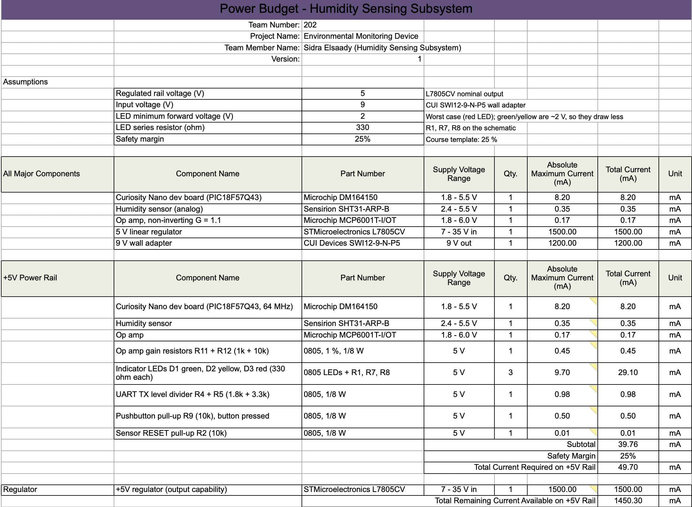
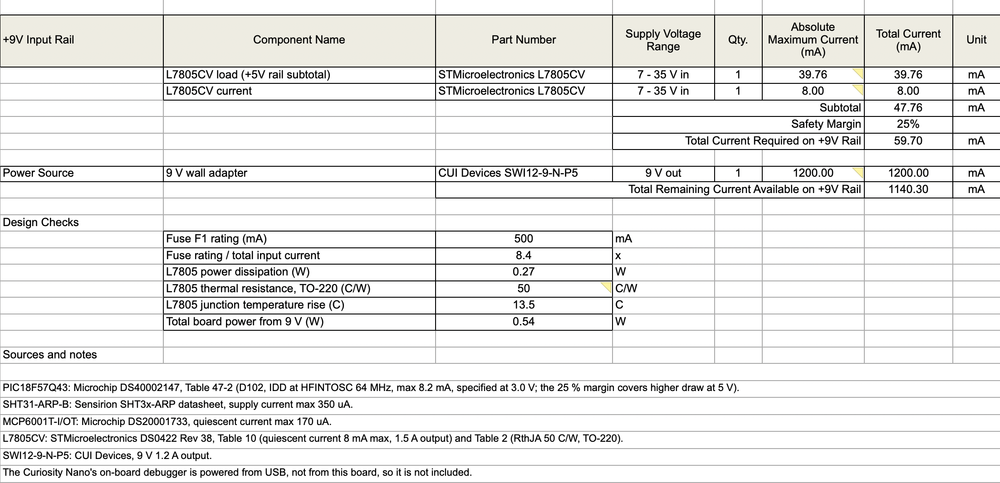

## Overview

A power budget adds up the worst-case current every part of my board can draw, so I can check that the regulator, the fuse, and the wall adapter are sized correctly and that nothing will overheat. I listed every part that draws current on the regulated **+5 V rail**: the Curiosity Nano, the SHT31-ARP-B humidity sensor, the MCP6001 op amp and its gain resistors, the three indicator LEDs, the UART level-shift divider, and the button and reset pull-ups. Each value is the **maximum** current from the part's datasheet, or a worst-case calculation for resistors and LEDs. I then added a **25 % safety margin** and carried the result back to the **+9 V input rail**, where the L7805CV's own quiescent current is added.

## Conclusions

From the prepared power budget:

- **+5 V rail:** the board draws at most **39.8 mA**, or **49.7 mA with a 25 % margin**. The L7805CV can supply 1.5 A, leaving about **1.45 A unused**, so the regulator is far from its limit. The three LEDs are the largest load (about 29 mA together), more than the microcontroller itself.
- **+9 V input:** including the L7805's 8 mA quiescent current, the board needs at most **59.7 mA** from the wall adapter. The CUI SWI12-9-N-P5 is rated for 1.2 A, so it has plenty of headroom, and the board stays well under the team's 1.5 A input limit (PR 6.1).
- **Fuse:** the 500 mA fuse is about **8× the worst-case input current**. It will not blow during normal operation, and it will still open on a short circuit.
- **Regulator heat:** the L7805 dissipates about **0.27 W**. With the TO-220's 50 °C/W junction-to-ambient rating, that is only about a **14 °C rise**, so **no heatsink is needed**. Its minimum load of 5 mA is always met.
- **Total board power** is about **0.54 W** from the 9 V supply.
- **UART level:** Team 202 uses 3.3 V UART, so the R4/R5 divider that shifts the PIC's 5 V TX down to about 3.2 V is included (about 1 mA while TX is high).

## Resources

The power budget is available as a [PDF download](SE_Power_Budget.pdf) and as a [Microsoft Excel sheet](SE_Power_Budget.xlsx).

