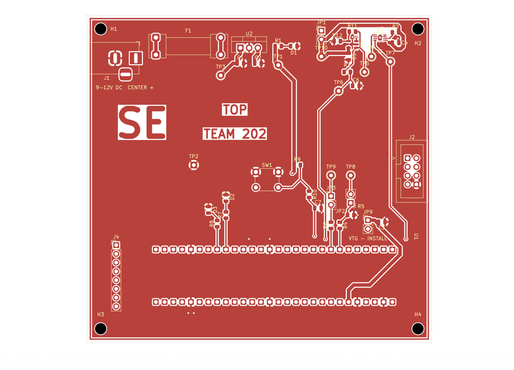
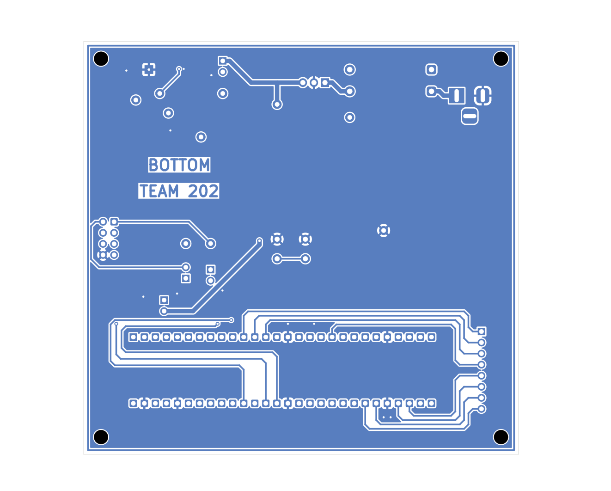

## Overview

**Sidra Elsaady| Team 202 Weather Gadget | Revision L.1**

## PCB layout
(SidraElsaady202_PCB_Layout.pdf)

### Front

### Back

## Downloads

| File | Contents |
| --- | --- |
| [PCB layout PDF](SidraElsaady202_PCB_Layout.pdf) | Front and back views in one document |
| [Editable KiCad project ZIP](SidraElsaady2.zip) | Schematic, PCB, project settings, and custom libraries. Extract and open `Revision-L.kicad_pro` in KiCad 10. |
| [Gerber and drill ZIP](gerber_new.zip) | Fabrication files for both copper layers, solder mask, silkscreen, and board outline, with separate plated and unplated drill files |
| [KiCad DRC confirmation](finaldrccheck.pdf) | The full PCB and Design Rules Checker results in one screenshot |

## Verification

