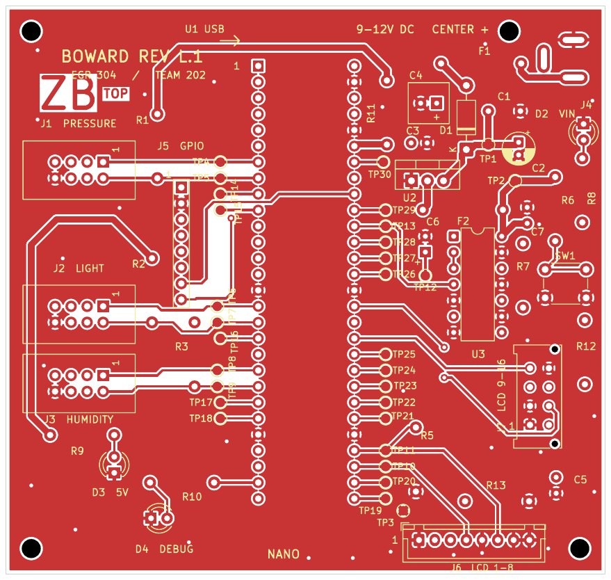
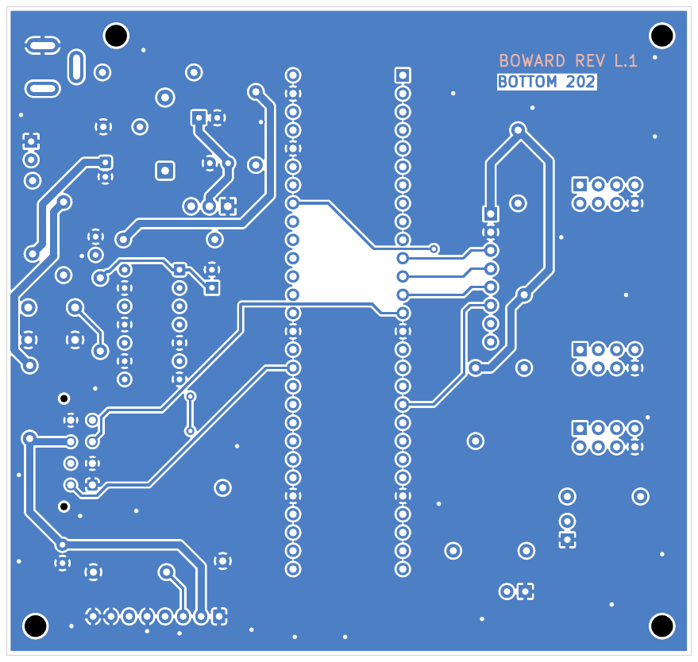

## Overview

**Zander Boward | Team 202 Weather Gadget | Revision L.1**

The LCD display subsystem uses a 95 × 90 mm, two-layer PCB. A PIC18F57Q43 Curiosity Nano connects to the pressure, light, and humidity sensor boards over UART. The PCB carries the display control and power circuitry, and the LCD connects through a removable harness at J6 and J7. A pushbutton selects which sensor reading to display.

The board uses ground pours on both copper layers and 40 mil power traces. Four unplated mounting holes secure the board, and 30 labeled test points provide access for bring-up and debugging. See the [schematic](../04-Schematic/schematic.md) for the circuit and connector pin assignments.

## PCB layout

### Front

### Back

## Downloads

| File | Contents |
| --- | --- |
| [PCB layout PDF](Revision-L-PCB-Views.pdf) | Front and back views in one document |
| [Editable KiCad project ZIP](Boward-Revision-L.1-KiCad.zip) | Schematic, PCB, project settings, and custom libraries. Extract and open `Revision-L.kicad_pro` in KiCad 10. |
| [Gerber and drill ZIP](ZanderBoward202.zip) | Fabrication files for both copper layers, solder mask, silkscreen, and board outline, with separate plated and unplated drill files |
| [KiCad DRC confirmation](Revision-L-DRC-Screenshot.pdf) | The full PCB and Design Rules Checker results in one screenshot |

## Verification

KiCad reported zero design rule errors and zero unconnected items. The four courtyard warnings refer to the unplated mounting holes H1–H4. A separate schematic parity check found zero mismatches. The Gerber archive above is the same one checked in JLCDFM.

